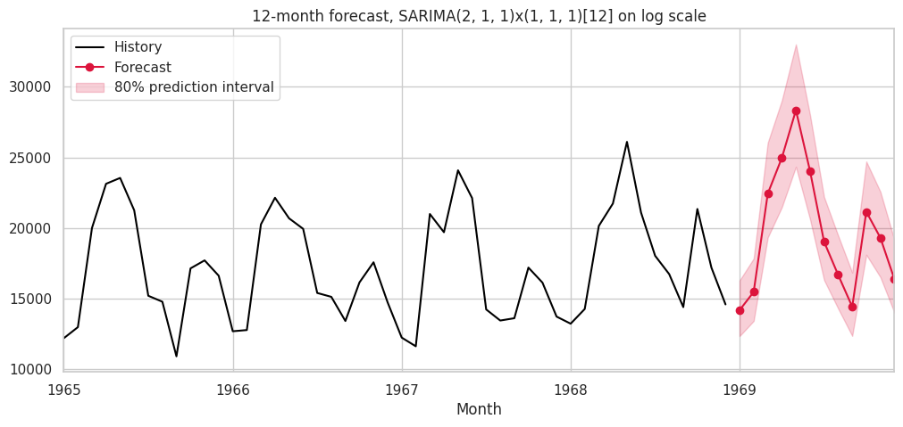

# Monthly Sales Forecasting: Classical Statistics + Time-Aware Validation

Forecasting 12 months of sales for a real monthly series (Quebec car sales, 1960-1968, 108 observations), with emphasis on **statistical reasoning, leak-free validation, and being honest about limitations** rather than just calling a model.



## What this project covers
| Stage | What I did |
|---|---|
| Data quality | Checked missing values, duplicates, gaps, non-positive values; enforced monthly frequency |
| EDA | Trend, seasonality, year-over-year growth, seasonal index, STL decomposition (trend strength 0.87, seasonal strength 0.91) |
| Statistics | ADF + KPSS stationarity tests (opposite null hypotheses), variance/log-transform check, ACF/PACF to guide model orders |
| Validation | Time-ordered hold-out (last 12 months) + rolling-origin cross-validation (4 folds); no random shuffling |
| Models | Naive, seasonal naive, Holt-Winters (damped), SARIMA (order chosen by AIC on training data only), Gradient Boosting with lag features |
| Metrics | MAE, RMSE, MAPE, MASE (scaled vs seasonal naive) |
| Diagnostics | Ljung-Box (autocorrelation), Shapiro-Wilk + Q-Q (normality), prediction-interval coverage check |
| Limitations | Dedicated section on data limits, modelling limits, and next steps |

## Key results
| Model | CV MAPE % (4 folds) | Hold-out MAPE % | Hold-out MASE |
|---|---|---|---|
| Naive | 21.1 | 22.3 | 2.98 |
| Seasonal naive | **9.6** | 10.8 | 1.27 |
| Holt-Winters (damped) | 11.1 | 9.5 | 1.12 |
| SARIMA | 12.0 | **7.8** | **0.91** |
| Gradient boosting | 13.6 | 9.0 | 1.15 |

**Findings**
- Seasonality carries most of the forecastable signal: every seasonal method roughly halves the error of the naive baseline.
- **Model rankings are unstable.** Seasonal naive wins in cross-validation; SARIMA wins on the final hold-out. With ~100 points I would not claim SARIMA is definitively better, so a simple seasonal baseline is hard to beat on a series this short.
- SARIMA residuals pass diagnostics (Ljung-Box p = 0.56 / 0.33; Shapiro-Wilk p ~ 0.09), supporting the use of its prediction intervals. 80% interval covered 83% of hold-out points (only 12 points, so weak evidence).
- All models missed a sharp October 1968 spike, a reminder that statistical models can't anticipate one-off events.

## Applicability and limitations (summary)
- **Fits:** short-horizon (<= 12 month) planning of aggregate monthly demand with stable seasonality; the *methodology* transfers to other sales series.
- **Data limits:** tiny sample (9 seasonal cycles), old single-market data, univariate (no price/promotion/economic drivers), aggregated, undocumented collection.
- **Model limits:** assumes the future resembles the past (no structural breaks), intervals ignore model-selection uncertainty, hold-out is just 12 points, tree models can't extrapolate trends, some SARIMA candidate fits had convergence warnings.
- Full discussion in Section 9 of the notebook.

## Run it
```bash
pip install -r requirements.txt
jupyter notebook sales_forecasting.ipynb
```
Data: `data/monthly_car_sales.csv` (public dataset, originally from Abraham & Ledolter, *Statistical Methods for Forecasting*; copy hosted in Jason Brownlee's Datasets repository).

## Project structure
```
sales-forecasting/
  sales_forecasting.ipynb   # full analysis with outputs
  sales_forecasting.html    # same notebook, viewable in a browser
  data/monthly_car_sales.csv
  images/                   # figures used in this README
  requirements.txt
```
